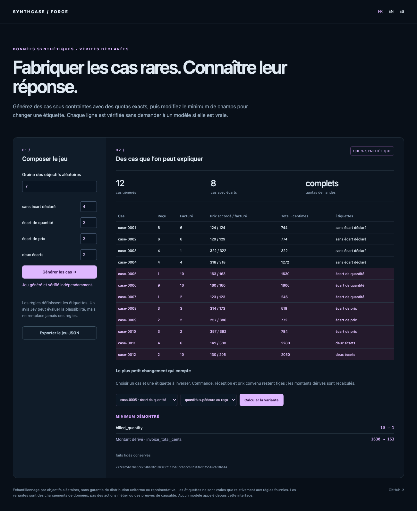

# Synthcase Forge

[Français](README.md) · [English](README.en.md)

**Crear casos raros con respuestas conocidas y encontrar el cambio mínimo que invierte una respuesta.**

OR-Tools genera casos con restricciones y cuotas explícitas. Un comprobador Python independiente recalcula reglas, productos y etiquetas. Una variante mínima invierte una etiqueta sin cambiar hechos inmutables. Exportación SQLite con claves externas e índices de etiquetas.



## Probar

Python 3.11 o posterior. Sin clave para generar, verificar o explorar.

```sh
python3 -m venv .venv
.venv/bin/pip install .
.venv/bin/python -m synthcase serve --lang es
```

Abrir `http://127.0.0.1:8767/?lang=es`. Doce casos: cuatro sin diferencias declaradas, tres de cantidad, tres de precio y dos combinados. Elegir un caso: el solucionador minimiza campos cambiados y después su distancia; recalcula los totales derivados. Pedido, recepción y precio acordado permanecen fijos.

```sh
.venv/bin/python -m synthcase generate synthcase/examples/invoice-cases.json --seed 7 --output .local/data.json
.venv/bin/python -m synthcase pair .local/data.json case-0005 quantity_exceeds_receipt
.venv/bin/python -m synthcase export .local/data.json .local/cases.sqlite
```

La exportación no sobrescribe bases existentes. Interfaz y mensajes CLI en FR/EN/ES.

## Especificación inspeccionable

- `variables`: límites enteros por campo;
- `constraints`: predicados lineales, conjunciones, disyunciones y negación;
- `products`: campos derivados, por ejemplo cantidad × precio;
- `labels`: verdades definidas por predicados, nunca por un modelo;
- `cohorts`: cantidades exactas y etiquetas requeridas;
- `immutable`: hechos conservados en las variantes.

La factura es un ejemplo, sin afirmar conformidad fiscal. Hasta veinte variables y cien casos por solicitud; filas distintas. Reglas imposibles o dominios agotados producen `partial`, cuotas pendientes y un conflicto suficiente si está disponible; no necesariamente mínimo.

La semilla fija objetivos aleatorios que el solucionador intenta aproximar. **No es muestreo uniforme ni distribución representativa de facturas reales**. Una resolución limitada puede devolver `FEASIBLE` y variar entre máquinas; cada fila conserva `solve_status`. Solo afirma minimalidad demostrada para campos independientes; los cambios derivados se muestran aparte.

## Jev opina sobre plausibilidad sin redefinir verdad

La revisión opcional realiza **una llamada, hasta seis preguntas**, con un representante por cohorte. Solicita `plausible / implausible / uncertain`, conserva probabilidades y envía opiniones poco seguras a revisión. Nunca modifica etiquetas calculadas. El navegador no llama a modelos ni expone rutas de claves.

```sh
.venv/bin/python -m synthcase review .local/data.json --lang es --output .local/opinions.json
```

Lee `TYPESAFE_API_KEY` del entorno. `--env .env` exige archivo ignorado por Git y permisos `600`. Nunca muestra claves, cabeceras ni errores completos del proveedor. Verificación TLS activa mediante certifi; sin seguir redirecciones autenticadas.

Ensayo real del 19 de octubre de 2026: Jev `jev-1.13.0` consideró plausibles tres representantes con confianzas **1,00 / 0,72 / 0,58**, usando **1.044 tokens de entrada y 147 de salida**. Los dos últimos requieren revisión con umbral declarado 0,8. Verifica transporte y separación de opiniones, **no calidad general del modelo ni realismo del conjunto**. Generación, pruebas y CI sin conexión; no se publica ninguna clave.

## Herramientas existentes y límites

[SDV](https://docs.sdv.dev/sdv/modeling/constraint-augmented-generation-cag.md) ya genera datos con restricciones. No se inventa ese principio: la demostración reúne **cuotas de casos raros → etiquetas conocidas → variante de intervención mínima → opinión separada**. [OR-Tools](https://developers.google.com/optimization/cp) aporta resolución y [TypeSafe Choice](https://docs.typesafe.ai/primitives/choice) la revisión opcional.

Una etiqueta solo es verdadera respecto a su regla. Reglas incompletas pueden generar situaciones poco plausibles. Las variantes cambian registros bajo ecuaciones declaradas; no son acciones de negocio ni evidencia causal. Sin afirmar privacidad diferencial, conservación de distribución fuente, validación jurídica ni superioridad SOTA.

## Validación

```sh
.venv/bin/python -m unittest discover -s tests -v
npm ci
npx playwright install chromium
PYTHON=.venv/bin/python npm run test:browser
npm run format:check
```

Catorce pruebas cubren cuotas, productos, etiquetas, unicidad, imposibilidades, variantes frente a enumeración exhaustiva, exportación SQLite y revisión Jev simulada. Navegador FR/EN/ES, móvil, cuotas y ausencia de rutas secretas; CI Python 3.11/3.12 y rueda fuera de fuentes. Salida 1 para generación parcial o variante imposible, 2 para entrada/transporte no válido. Licencia MIT; alfa de investigación.
